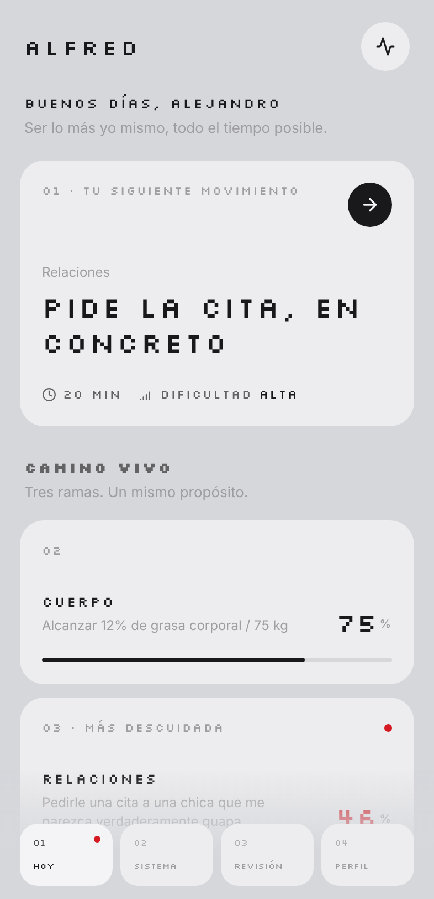
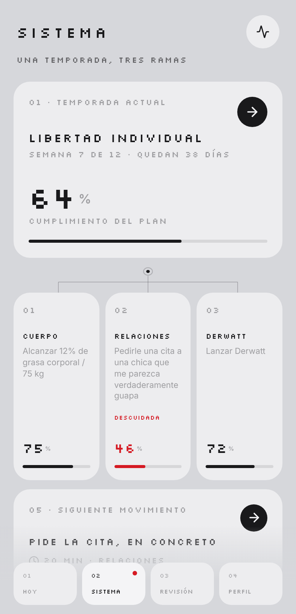
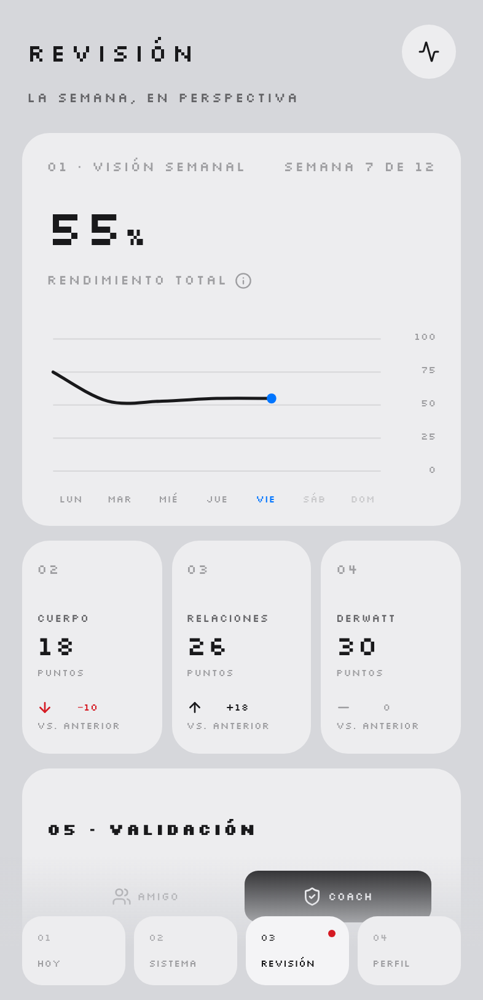

# Alfred

Prototipo funcional de un sistema personal de temporada: **un objetivo, tres ramas,
un movimiento cada vez**.

Alfred no es una lista de tareas. Traduce un objetivo de temporada en un plan
semanal repartido entre tres áreas de tu vida, te propone el siguiente movimiento
—uno solo, el de la rama más descuidada— y mide tu fidelidad al plan, no tu
fuerza de voluntad.

| Hoy | Sistema | Revisión |
|---|---|---|
|  |  |  |

## Qué hace

| Pantalla | Para qué sirve |
|---|---|
| **Alta** | Defines nombre, objetivo de temporada, tus tres ramas y su duración. Alfred genera el plan completo. |
| **Hoy** | Un saludo, un movimiento y el estado vivo de las tres ramas. Nada más. |
| **Sistema** | La temporada al completo: cumplimiento, árbol de ramas, área más descuidada y confirmación rápida. |
| **Revisión** | La semana en perspectiva: curva de cumplimiento, puntos por rama y accountability con un amigo o coach. |
| **Perfil** | Tus datos, tus ramas, copia de seguridad y arranque de una temporada nueva. |
| **Detalle de rama** | Las semanas de esa rama, movimiento a movimiento, con su día planeado. |

Todo funciona de verdad: confirmar un movimiento recalcula el cumplimiento,
mueve la siguiente propuesta, alimenta la curva semanal y actualiza la racha.
El estado se guarda en el navegador, sin cuenta ni servidor.

## Cómo funcionan los números

- Cada movimiento vale puntos según su dificultad: **8** baja, **12** media, **18** alta.
- **Cumplimiento**: puntos confirmados frente a los que el plan ha pedido hasta hoy.
  No mide distancia al objetivo final, mide fidelidad.
- **Rendimiento semanal**: el mismo cociente, acumulado día a día dentro de la
  semana natural. Los días que aún no han llegado no se dibujan.
- **Comparación entre semanas**: siempre a igual tramo. El jueves se compara con
  el jueves anterior, no con una semana completa.
- **Racha**: días consecutivos en los que todo lo planeado quedó confirmado. Un
  día sin nada planeado no la rompe.
- **Saltar** un movimiento no resta: deja de sumar y guarda tu motivo para la revisión.

## Ritmo del plan

Cada rama recibe cuatro movimientos por semana, con día fijo: lunes, martes,
jueves y sábado. Ese ritmo es lo que permite comparar semanas y saber, un jueves
por la tarde, si vas por delante o por detrás.

## Instalarla en el móvil

Alfred es una PWA: se instala en la pantalla de inicio, arranca a pantalla
completa y funciona sin conexión.

1. Abre la dirección publicada en el móvil.
2. **iPhone (Safari):** Compartir → *Añadir a pantalla de inicio*.
   **Android (Chrome):** menú ⋮ → *Instalar aplicación*.
3. Ábrela desde el icono. A partir de ahí no necesita red.

El despliegue es automático: cada empujón a la rama lanza el flujo de trabajo
de `.github/workflows/pages.yml`, que construye y publica en GitHub Pages.
La primera vez hay que activar Pages en *Settings → Pages* eligiendo
**GitHub Actions** como origen.

Un service worker (`scripts/build-sw.mjs` lo genera con la lista real de
archivos del build) guarda la app entera en el dispositivo. La versión de la
caché es el hash del contenido: una visita repetida no descarga nada y un
despliegue nuevo se recoge solo.

## Desarrollo

```bash
npm install
npm run dev        # servidor de desarrollo
npm run build      # comprobación de tipos + build de producción
npm run preview    # sirve el build
```

Sin dependencias de UI más allá de React y [lucide](https://lucide.dev) para los
pocos iconos que quedan. El diseño vive en `src/styles/tokens.css`: metal,
tinta, escala tipográfica, radios y tiempos. La tipografía viaja dentro del
paquete, así que la app no hace ninguna petición externa.

## El sistema visual: Liquid Metal

Aluminio anodizado y matriz de píxeles. Superficies planas y mate —sin
degradados ni sombras—: lo que separa una tarjeta del fondo es su luz, no un
borde. Todo rótulo va en mayúsculas, monoespaciado y con aire entre letras.

El color no decora, avisa. Solo hay dos: **rojo** para lo que reclama atención
—la rama más descuidada, la sección donde estás, un retroceso frente a la
semana anterior— y **azul** para lo que está en curso, que aparece una sola vez,
en el punto de hoy sobre la curva. Las ramas ya no tienen color propio: se
distinguen por su número, que es también el orden en que el sistema las mira.

Dos voces tipográficas, cada una con su trabajo:

- **Silkscreen** para rótulos, etiquetas y cifras. Se eligió entre varias
  matrices porque dibuja las mayúsculas acentuadas —DÍAS, REVISIÓN, ÁREA— en
  lugar de rebajarlas a minúscula, que en español se lee como una errata.
- **La sans del sistema** para lo que se lee de corrido: los pasos de un
  movimiento, las metas de cada rama, la prosa de las hojas. Una matriz es una
  voz, no un cuerpo de texto.

## Estructura

```
src/
  app/        modelo, motor de cálculo, catálogo de áreas y estado persistido
  components/ piezas de interfaz reutilizables
  screens/    una pantalla por sección
  styles/     tokens y composición
```

- `app/engine.ts` — semanas, cumplimiento, siguiente movimiento, curva y racha.
- `app/pillars.ts` — cinco áreas (Cuerpo, Relaciones, Proyecto, Mente, Finanzas)
  con sus doce movimientos cada una.
- `app/store.tsx` — reductor, persistencia en `localStorage` y temporada de ejemplo.

## Temporada de ejemplo

En el alta y en Perfil hay un botón para cargar una temporada ilustrativa a
mitad de camino. Los datos son inventados y están ahí para poder recorrer el
sistema sin esperar siete semanas.
